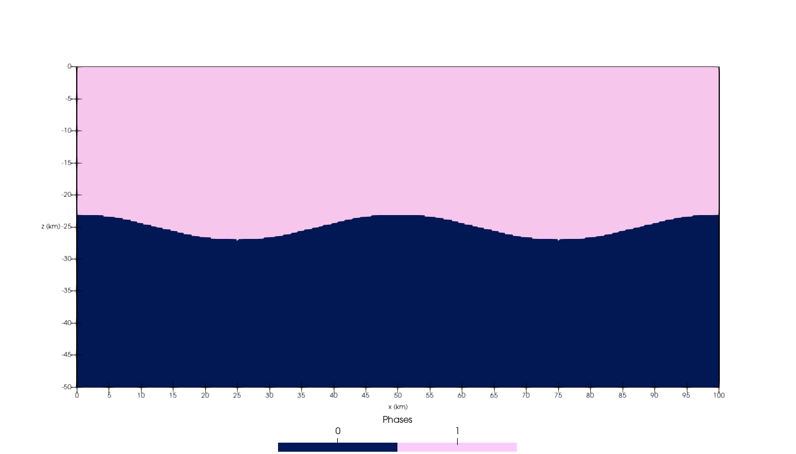
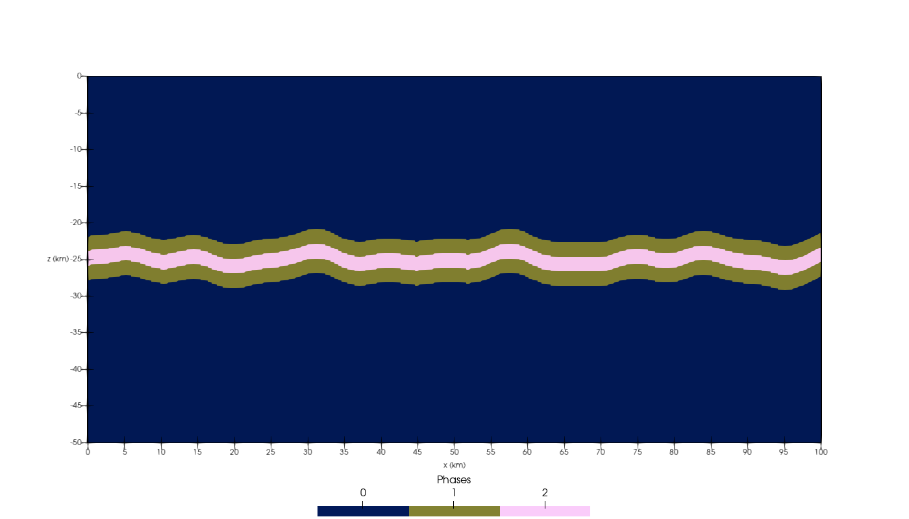
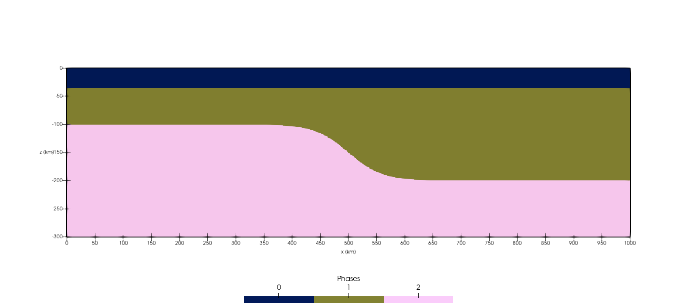
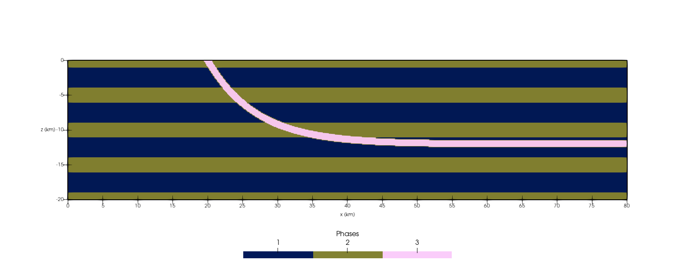
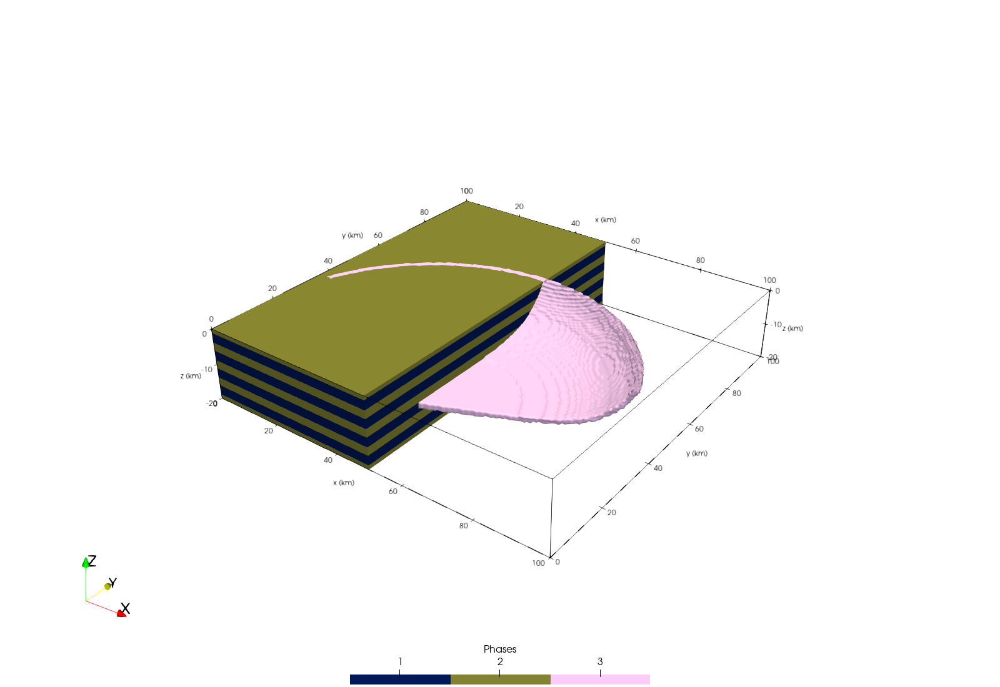
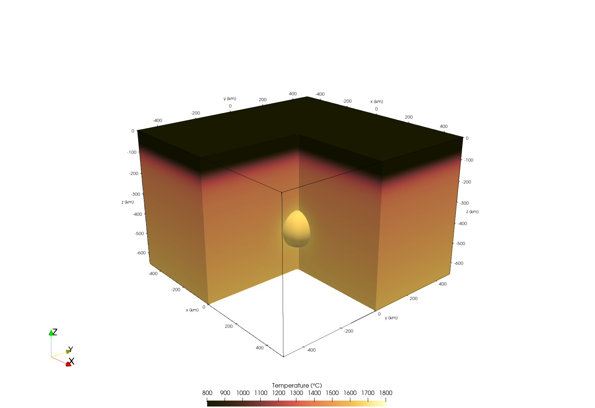

```@meta
EditURL = "../../../tutorials/Tutorial_NumericalModel_Geometries.jl"
```

# Curved layers, curved faults and thermal anomalies

### Aim
This tutorial shows how to add geometries that are common in geodynamic models but are not boxes:
layers with perturbed or curved interfaces, listric faults and faults with a curved surface trace, and
smooth (Gaussian) thermal anomalies such as plumes.

### Layers with curved interfaces

The bounds of `add_layer!` in `zlim` are numbers or functions `z(x, y)`. A function gives a perturbed
interface, as used to seed a Rayleigh-Taylor instability. We start with a 2D section of 100 by 50 km:

```julia
using GeophysicalModelGenerator

Grid2D = CartData(xyz_grid(range(0, 100, 401), 0, range(-50, 0, 201)))
Phases_RT = zeros(Int64, size(Grid2D))
Temp_RT = zeros(size(Grid2D))
```

The dense layer (phase 1) lies on top; its bottom is a cosine with an amplitude of 2 km:

```julia
add_layer!(Phases_RT, Temp_RT, Grid2D; zlim = ((x, y) -> -25 + 2cospi(x / 25), 0), phase = ConstantPhase(1))
```



Both bounds can be functions. Below a curved top surface, `LithosphericPhases` and `HalfspaceCoolingTemp`
measure depth from that surface, so the layers inside follow it. This gives a perturbed multilayer, as used
in folding models:

```julia
perturb(x) = 0.6sinpi(x / 12.5) + 0.4sinpi(x / 7.1 + 0.3) + 0.3sinpi(x / 4.3 + 1.1)
Phases_fold = zeros(Int64, size(Grid2D))
Temp_fold = zeros(size(Grid2D))
add_layer!(
    Phases_fold, Temp_fold, Grid2D; zlim = ((x, y) -> -28 + perturb(x), (x, y) -> -22 + perturb(x)),
    phase = LithosphericPhases(Layers = [2, 2], Phases = [1, 2, 1])
)
```



A curved bottom also describes a lithosphere of variable thickness. Here, the lithosphere-asthenosphere
boundary deepens from 100 to 200 km across a craton edge, while the crust (phase 0) stays 35 km thick:

```julia
Grid_craton = CartData(xyz_grid(range(0, 1000, 501), 0, range(-300, 0, 301)))
Phases_craton = fill(2, size(Grid_craton))
Temp_craton = zeros(size(Grid_craton))
lab(x, y) = -100 - 100 * (1 + tanh((x - 500) / 60)) / 2
add_layer!(Phases_craton, Temp_craton, Grid_craton; zlim = (lab, 0), phase = LithosphericPhases(Layers = [35], Phases = [0, 1]))
```



A bound can also be a surface `CartData`, such as imported topography or a Moho map, which is interpolated
linearly. The surface must cover the layer in `x` and `y`. Here, we build a Moho surface that deepens towards
the craton and use it as the base of the crust:

```julia
Moho = CartData(xyz_grid(range(-10, 1010, 103), range(-10, 10, 3), 0))
moho_depth = -30 .- 15 .* (1 .+ tanh.((Moho.x.val .- 500) ./ 60)) ./ 2
Moho = CartData(Moho.x.val, Moho.y.val, moho_depth, (; Depth = moho_depth))
Phases_moho = fill(2, size(Grid_craton))
add_layer!(Phases_moho, Temp_craton, Grid_craton; zlim = (Moho, 0), phase = ConstantPhase(0))
```

We save the setups to inspect them in Paraview:

```julia
write_paraview(addfield(Grid2D, (; Phases_RT, Phases_fold)), "Perturbed_layers")
write_paraview(addfield(Grid_craton, (; Phases = Phases_craton, Phases_moho)), "Craton_edge")
```

### Listric faults

`add_fault!` with `DetachmentDepth` adds a listric fault: it starts with `DipAngle` (measured from the
vertical) at `z = 0` and flattens with depth into a horizontal detachment. We cut it through a layered crust:

```julia
Grid_fault = CartData(xyz_grid(range(0, 80, 641), range(0, 10, 3), range(-20, 0, 161)))
Phases_fault = ones(Int64, size(Grid_fault))
Temp_fault = zeros(size(Grid_fault))
add_stripes!(Phases_fault, Grid_fault; stripAxes = (0, 0, 1), stripeWidth = 2, stripeSpacing = 5, phase = ConstantPhase(1), stripePhase = ConstantPhase(2))
add_fault!(
    Phases_fault, Temp_fault, Grid_fault; Start = (20, 0), End = (20, 10), Fault_thickness = 1.0, DipAngle = 30,
    DetachmentDepth = 12, phase = ConstantPhase(3)
)
write_paraview(addfield(Grid_fault, (; Phases = Phases_fault)), "Listric_fault")
```



### Faults with a curved trace in 3D

`Trace` replaces `Start` and `End` by a polyline, so that the fault follows a curved surface trace. The fault
dips perpendicular to the trace, to its right for a positive `DipAngle`. Combined with `DetachmentDepth`, this
gives the spoon shape of a listric normal fault at the head of a landslide or a rift-bounding fault:

```julia
Grid3D = CartData(xyz_grid(range(0, 100, 161), range(0, 100, 161), range(-20, 0, 61)))
Phases3D = ones(Int64, size(Grid3D))
Temp3D = zeros(size(Grid3D))
add_stripes!(Phases3D, Grid3D; stripAxes = (0, 0, 1), stripeWidth = 2, stripeSpacing = 5, phase = ConstantPhase(1), stripePhase = ConstantPhase(2))
```

The trace is an arc around (50, 20) from 20° to 160°, drawn counterclockwise, so that a negative
`DipAngle` dips towards the center of the arc:

```julia
arc = [(50 + 50cosd(α), 20 + 50sind(α)) for α in 20:5:160]
add_fault!(
    Phases3D, Temp3D, Grid3D; Trace = arc, Fault_thickness = 1.5, DipAngle = -30,
    DetachmentDepth = 12, phase = ConstantPhase(3)
)
```

We save the 3D setup to inspect it in Paraview:

```julia
Grid3D = addfield(Grid3D, (; Phases = Phases3D, Temp = Temp3D))
write_paraview(Grid3D, "Curved_listric_fault")
```



### Curved trenches

A `Trench` likewise takes a `Trace`, so that the slab of `add_slab!` follows a curved trench. Here the trace is a
Bézier curve, sampled with `bezier_curve`, and `Bending` gives the dip profile along the slab: from 0° at the trench,
the dip increases to 30° over 100 km and then to 60° over the next 250 km. The slab dips to the right of the trace
(`direction = -1`), i.e. to the east. Its temperature blends half-space cooling at the trench into the solution of
McKenzie (1969) for a slab sinking at 3 cm/yr, which is heated from its surface by the mantle: with `dir = :X`,
`LinearWeightedTemperature` blends the two along the slab down to `d_decoupling` (100 km):

```julia
Grid_arc = CartData(xyz_grid(range(0, 1000, 101), range(0, 1000, 101), range(-400, 0, 41)))
Phases_arc = ones(Int64, size(Grid_arc))
Temp_arc = fill(1350.0, size(Grid_arc))
trench_arc = Trench(
    Trace = bezier_curve([(350.0, 0.0), (350.0, 450.0), (650.0, 550.0), (650.0, 1000.0)], 50), direction = -1.0,
    Bending = [(30, 100), (60, 250)], Thickness = 80.0, WeakzoneThickness = 10.0, WeakzonePhase = 3
)
slab_temperature = LinearWeightedTemperature(
    F1 = HalfspaceCoolingTemp(Age = 50), F2 = McKenzie_subducting_slab(Tsurface = 0, Adiabat = 0, v_cm_yr = 3), dir = :X
)
add_slab!(Phases_arc, Temp_arc, Grid_arc, trench_arc; phase = ConstantPhase(2), T = slab_temperature)
```

The slab has the same profile everywhere along the trench. For slabs whose sections change along the trench, see
the tutorial [Slab break-off](@ref), which describes the slab with a Bézier surface (`BezierSlab`).

### Gaussian thermal anomalies

`GaussianTemp` adds a Gaussian temperature anomaly to the current temperature, centered in the region it is added to.
We use it for the classic initial condition of plume-lithosphere models: a hot plume head in an adiabatic mantle
(0.4 K/km) beneath a cooling lithosphere with a crust (phase 0), mantle lithosphere (phase 1) and asthenosphere
(phase 2):

```julia
Grid_plume = CartData(xyz_grid(range(-500, 500, 101), range(-500, 500, 101), range(-660, 0, 67)))
Phases_plume = fill(2, size(Grid_plume))
Temp_plume = 1350 .- 0.4 .* Grid_plume.z.val
```

The lithosphere cools from the surface and merges into the adiabat at its base:

```julia
add_box!(
    Phases_plume, Temp_plume, Grid_plume; xlim = (-500, 500), ylim = (-500, 500), zlim = (-200, 0),
    phase = LithosphericPhases(Layers = [30, 70, 100], Phases = [0, 1, 2]), T = HalfspaceCoolingTemp(Age = 80, Adiabat = 0.4)
)
```

The plume head (phase 3) is 250 K hotter than the mantle at its center. The sphere extends to three widths, so
that the anomaly fades smoothly into the mantle:

```julia
add_sphere!(
    Phases_plume, Temp_plume, Grid_plume; cen = (0, 0, -430), radius = 210, phase = ConstantPhase(3),
    T = GaussianTemp(Amplitude = 250, Width = 70)
)
```

A width of `Inf` along an axis keeps the anomaly constant along it, e.g. `Width = (25, 25, Inf)` inside a
cylinder for a plume conduit. We save the setup:

```julia
Grid_plume = addfield(Grid_plume, (; Phases = Phases_plume, Temp = Temp_plume))
write_paraview(Grid_plume, "Plume")
```


