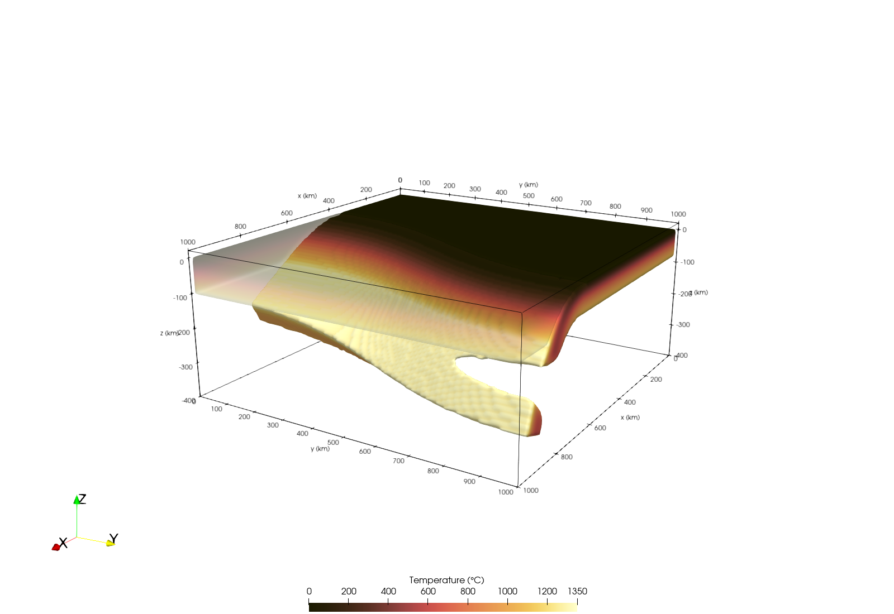

```@meta
EditURL = "../../../tutorials/Tutorial_SlabBreakoff.jl"
```

# Slab break-off

### Aim
Slab break-off often starts at the lateral end of a slab, where the slab necks and detaches, and then propagates
along the trench as a slab tear. This tutorial builds a subduction zone whose slab is described by a Bézier
surface and lets the slab thin towards a break-off at one end, as initial condition for such models.

### Subduction zone
We use sticky air (phase 0), upper mantle (phase 1), an oceanic plate with crust (phase 2) and lithosphere
(phase 3), and a continental plate with crust (phase 4) and lithosphere (phase 5). The trench is a Bézier curve
in map view, and the plates share it as their boundary:

```julia
using GeophysicalModelGenerator

Grid = CartData(xyz_grid(range(0, 1000, 151), range(0, 1000, 151), range(-400, 20, 64)))
Phases = ones(Int64, size(Grid))
Temp = fill(1350.0, size(Grid))
add_box!(Phases, Temp, Grid; xlim = (0, 1000), zlim = (0, 20), phase = ConstantPhase(0), T = ConstantTemp(0))

trench = [(350.0, 0.0), (350.0, 450.0), (650.0, 550.0), (650.0, 1000.0)]
trench_line = bezier_curve(trench, 50)
```

The oceanic plate is 80 km thick; its temperature continues to 150 km depth, where it reaches the mantle temperature

```julia
oceanic = LithosphericPhases(Layers = [10, 70], Phases = [2, 3, 1])
add_plate!(
    Phases, Temp, Grid; xlim = [first.(trench_line); 0; 0], ylim = [last.(trench_line); 1000; 0],
    zlim = (-150, 0), phase = oceanic, T = HalfspaceCoolingTemp(Age = 50)
)
add_plate!(
    Phases, Temp, Grid; xlim = [first.(trench_line); 1000; 1000], ylim = [last.(trench_line); 1000; 0],
    zlim = (-100, 0), phase = LithosphericPhases(Layers = [35, 65], Phases = [4, 5]), T = LinearTemp(Ttop = 0, Tbot = 1350)
)
```

The sections of the slab steepen from 30° to 70° along the trench, so the slab reaches deepest at its northern end.
The last two sections are equal, so that the slab ends in the plane y = 1000 km, at the edge of the model:

```julia
section(dip) = [(0.0, 0.0), (120.0, 0.0), (220.0, -60.0), (220 + 250cosd(dip), -60 - 250sind(dip))]
dips = (30, 40, 70, 70)
control_point(t, (h, z)) = (t[1] + h, t[2], z)
Points = [control_point(trench[i], section(dips[i])[j]) for i in eachindex(trench), j in 1:4]
```

### Necking towards break-off
A `Tear` makes the slab neck and detach. Its four parameters are:
- `Depth`: the center depth of the tear, here 180 km.
- `Width`: the vertical width of the neck, here 40 km.
- `Start`: where the necking begins. The slab has its full thickness there.
- `Tip`: where the slab first tears through, at `Depth`. Between `Start` and `Tip` the slab thins progressively.
  Beyond the tip, the torn gap widens like a propagating tear, to `2 Width √(log A)` with
  `A = (a - Start) / (Tip - Start)` at distance `a` along the trench.

The neck also warms as it thins: where the slab is thinned by a factor φ, its temperature is blended with the
temperature before the slab is added, `T₀ + φ (T_slab - T₀)`, and the torn gap keeps that temperature.

`Start` and `Tip` given as map points `(x, y)` are projected onto the trench. Here they are the points of the trench curve
at y = 550 km and y = 770 km:

```julia
tear = Tear(; Depth = 180, Width = 40, Start = (527, 550), Tip = (620, 770))
```

Alternatively, `Start` and `Tip` can be given as distances along the trench, in km from its first point, as in
`Start = 585, Tip = 825`. This form is handier when the trench is not known as a set of map points.

The temperature of the slab is set within 150 km of its surface, where it reaches the mantle temperature, so that
it has no jump at the base of the slab. With depth, the slab warms from half-space cooling at the trench to the
solution of McKenzie (1969) for a slab sinking at 3 cm/yr, which is heated from its surface by the mantle.
`LinearWeightedTemperature` with `dir = :Y` blends the two with the depth of the slab surface, over the 100 km of
the continental plate, so that the top of the slab is as warm as the plate above it. This thermal envelope is
mantle (phase 1), which also removes the continental plate beneath the slab; the slab then sets the phases only:

```julia
slab_temperature = LinearWeightedTemperature(
    F1 = HalfspaceCoolingTemp(Age = 50), F2 = McKenzie_subducting_slab(Tsurface = 0, Adiabat = 0, v_cm_yr = 3),
    crit_dist = 100, dir = :Y
)
add_slab!(Phases, Temp, Grid, BezierSlab(; Points, Thickness = 150, Tear = tear); phase = ConstantPhase(1), T = slab_temperature)
add_slab!(Phases, Temp, Grid, BezierSlab(; Points, Thickness = 80, Tear = tear); phase = oceanic)
```

We save the setup to inspect it in Paraview:

```julia
Grid = addfield(Grid, (; Phases, Temp))
write_paraview(Grid, "Slab_breakoff")
```


