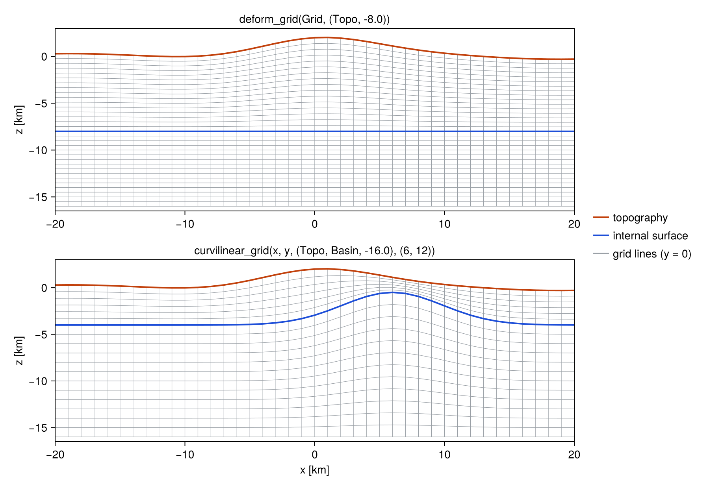

# Curvilinear grids

Many seismic wave propagation codes (for example spectral-element or finite-difference codes with a curvilinear grid) need a structured grid whose top follows the topography, and often also a grid whose levels follow internal interfaces such as the base of a sedimentary basin or the Moho. In GMG, such a grid is a `CartData` structure, which stores the full 3D coordinate arrays `x`, `y` and `z`. The `x` and `y` coordinates remain those of a regular (or rectilinear) grid, while the height `z` of each grid level varies from column to column.

Two functions create such grids:
- `deform_grid` deforms an existing grid vertically, such that some of its levels follow given surfaces. It keeps the vertical resolution of the grid and its fields.
- `curvilinear_grid` creates a layered grid between surfaces, with a given number of cells in each layer.

The surfaces can be `CartData` surfaces with any resolution (they are interpolated to the grid, and must cover it), numbers for flat surfaces, or functions `z(x, y)`.



## Example

We first create a topography and the base of a sedimentary basin. Usually, these come from data, for example from `import_topo` followed by `project_CartData`. Here, they are given on a coarser grid than the 3D grid:
```julia
using GeophysicalModelGenerator
Xs, Ys, _ = xyz_grid(range(-25, 25, 51), range(-25, 25, 51), 0)
H = @. 2 * exp(-(Xs^2 + Ys^2) / 40) + 0.3 * sin(Xs / 4)
Topo = CartData(Xs, Ys, H, (Topography = H,))
B = @. -4 + 3.5 * exp(-((Xs - 6)^2 + Ys^2) / 30)
Basin = CartData(Xs, Ys, B, (Z = B,))
```

A regular grid whose top follows the topography, and which is undeformed below 8 km depth (top of the figure):
```julia
X, Y, Z = xyz_grid(-20:0.5:20, -20:0.5:20, -16:0.5:0)
Grid = CartData(X, Y, Z, (Z = Z,))
Grid_topo = deform_grid(Grid, (Topo, -8.0))
```
Each surface is placed on the grid level whose mean height is closest to the mean height of the surface (here the top level and the level at -8 km), unless you give these levels with the `levels` keyword. In every column, the points between two such levels are stretched linearly.

A grid with 6 cells between the topography and the base of the basin, and 12 cells down to 16 km depth (bottom of the figure):
```julia
Grid_layers = curvilinear_grid(-20:0.5:20, -20:0.5:20, (Topo, Basin, -16.0), (6, 12); min_thickness = 0.02)
```
Where the basin is thinner than 6 × 0.02 km, or where its base lies above the topography (where it pinches out), its base is moved down such that all cells have a thickness of at least `min_thickness`. This avoids the degenerate cells that most wave propagation codes cannot handle.

The grid levels follow the surfaces exactly, so a point on a surface is not above or below it by a rounding error.

## Meshes for summation-by-parts finite-difference codes

Finite-difference codes with summation-by-parts (SBP) operators, such as the terrain-following solver of SeismicWavePC.jl, need the columns at the nodes of the SBP operator, which are equidistant except the outermost few on each side, and a block of at least 13 grid lines between two interfaces. `sbp_nodes` gives these nodes, `dz` sets the vertical spacing (where a layer is thickest) instead of the number of cells, and `spacing = :sbp` distributes the points of every layer like the SBP nodes. A 2D mesh (one `y` value) with grid lines along the topography and the Moho, and a flat bottom:
```julia
topo(x) = 1.5 * exp(-x^2 / 50)                         # surfaces as functions z(x), or as CartData surfaces
moho(x) = -30 + 3 * tanh(x / 10)
Mesh = curvilinear_grid(sbp_nodes(-50, 50, 401), 0, (topo, moho, -40.0); dz = 0.25, spacing = :sbp)
```
The material is then set at the points of the mesh with the usual tools, e.g.:
```julia
X, Y, Z = coordinate_grids(Mesh)
Phase, Temp = zeros(Int64, size(X)), zeros(size(X))
Phase[Z .< moho.(X)] .= 1                                                               # mantle
add_ellipsoid!(Phase, Temp, Mesh; cen = (0, 0, -6), axes = (4, 2, 1.5), phase = ConstantPhase(2))  # magma chamber
rho, vp = [2700.0, 3300.0, 2500.0][Phase .+ 1], [6.0, 8.0, 4.5][Phase .+ 1]            # kg/m³, km/s
Mesh = addfield(Mesh, (; rho, vp, vs = vp ./ sqrt(3)))
```
The heights of the grid points increase strictly in every column; surfaces that touch or cross raise an error (or pass `min_thickness`). 3D meshes are created in the same way, with `sbp_nodes` also for `y`.

## Model setups and data on curvilinear grids

The model setup functions evaluate each point of the grid separately and therefore work on curvilinear grids. A layer between two surfaces is added with `add_layer!` and surface bounds:
```julia
Phase = zeros(Int64, size(Grid_layers))
Temp = zeros(size(Grid_layers))
add_layer!(Phase, Temp, Grid_layers; zlim = (Basin, Topo), phase = ConstantPhase(1), T = LinearTemp(Ttop = 10, Tbot = 100))
Grid_layers = addfield(Grid_layers, (; Phase, Temp))
write_paraview(Grid_layers, "Grid_layers")
```
Seismic velocities, for example from a tomographic model, are interpolated onto the grid with `interpolate_datafields(Tomo, coordinate_grids(Grid_layers)...)`, or with `project_CartData` if the model is a `GeoData` set.

| Works on curvilinear grids | Notes |
|:---|:---|
| `write_paraview`, `movie_paraview`, `save_GMG`, `load_GMG` | written as a structured grid |
| `add_box!`, `add_layer!`, `add_sphere!`, `add_ellipsoid!`, `add_cylinder!`, `add_polygon!`, `add_slab!`, `add_fault!`, `add_volcano!`, `add_stripes!`, `compute_phase` | also with `cell = true` |
| `above_surface`, `below_surface` | |
| `interpolate_datafields`, `project_CartData`, `project_FEData_CartData` | to a curvilinear grid, and from one |
| `cross_section`, `extract_subvolume`, `interpolate_data_surface` | slices at a given depth are interpolated |
| `rotate_translate_scale`, `addfield`, `point_to_nearest_grid` | |
| `voxel_grav`, `voxel_grav_adjoint`, `topographic_effect` | cells are hexahedra with inclined top and bottom; stations on top of the grid by default |

When data are interpolated *from* a curvilinear grid, each cell is treated as a hexahedron with vertical edges, which is interpolated trilinearly (isoparametrically). This reproduces fields that vary linearly in `x`, `y` and `z` exactly.

Functions that need horizontal grid levels raise an error on a curvilinear grid: `write_ASAGI`, `visualise`, and `extract_subvolume` with `Interpolate = false` and a `Z_level` (or a `Depth_level` for `GeoData`). In these cases, first interpolate the data onto a regular grid with `interpolate_datafields`. LaMEM and pTatin use rectilinear grids, so their setups are not affected.

```@docs
deform_grid
curvilinear_grid
sbp_nodes
```
