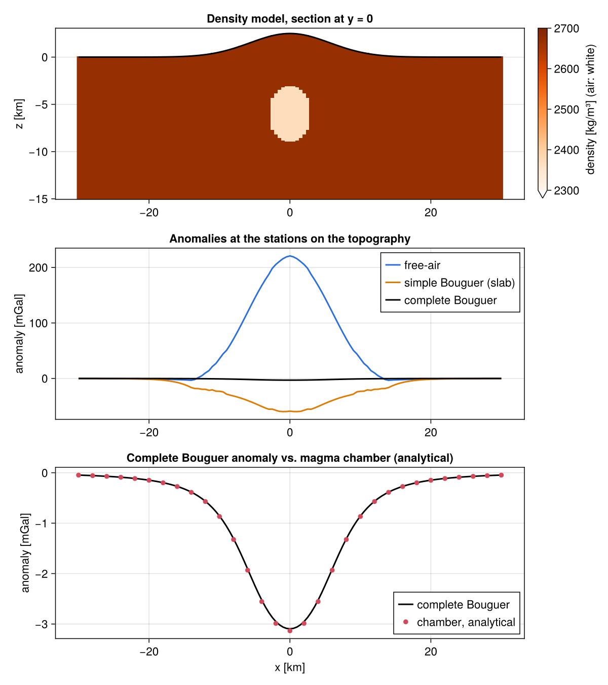
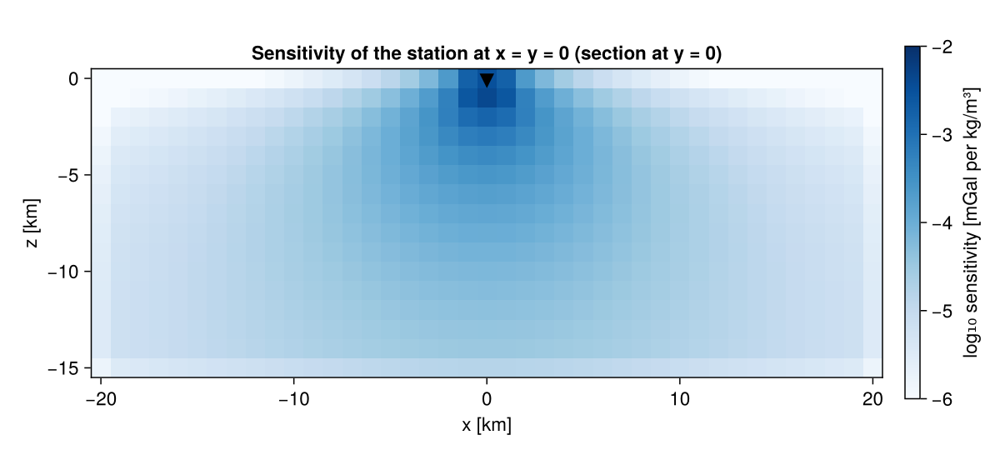
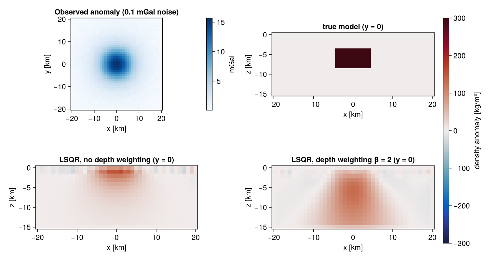
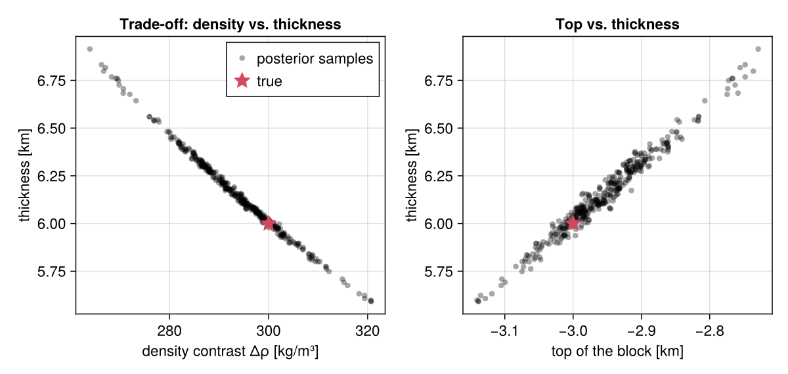

# Gravity code

The `voxel_grav` function computes gravity anomalies and their horizontal gradients from a 3D density model, on a flat Earth (arrays or `CartData`) or on the reference ellipsoid (`GeoData`), at the grid columns or at arbitrary stations. Every grid cell acts as a point mass at its centre, and cells close to a station are subdivided. The anomaly is linear in the density, and `voxel_grav_adjoint` computes the adjoint, i.e. the sensitivity of the anomaly to the density. Together they can be used to compute free-air and Bouguer anomalies, sensitivity maps, and deterministic or probabilistic (Hamiltonian Monte Carlo) inversions with general-purpose Julia packages. `normal_gravity`, `bouguer_correction` and `topographic_effect` turn observed gravity into anomalies that can be compared with the models.

This page explains the forward computation and then works through five examples: free-air and Bouguer anomalies of a volcano, a sensitivity map, a least-squares inversion, a probabilistic inversion with Turing.jl, and a probabilistic inversion with one parameter per grid point.

## Forward computation

```julia
using GeophysicalModelGenerator
X, Y, Z = xyz_grid(range(-20, 20, 41), range(-20, 20, 41), range(-15, 0, 16))   # km
RHO = fill(2700.0, size(X))
RHO[(abs.(X) .< 5) .& (abs.(Y) .< 5) .& (-9 .< Z .< -3)] .= 3000.0
dg, gradX, gradY = voxel_grav(X, Y, Z, RHO; refMod = "NE", lengthUnit = "km", outName = "Bouguer")
```

- The grid must be rectilinear: `X` varies only along the first dimension, `Y` along the second, `Z` along the third. The spacing may vary along each direction, e.g. finer cells near the surface.
- `dg` [mGal] is computed at the `x`, `y` coordinates of the grid, at the height `zRef`. This is either a number (default 0) or an array with a height for every surface point, e.g. the topography. Only the part of the model below `maximum(zRef)` is used. Arbitrary stations are possible with `GeoData` and `CartData` grids (see below).
- `gradX`, `gradY` are the horizontal gradients `∂dg/∂x`, `∂dg/∂y` [mGal/m; 1 mGal/m = 10⁴ Eötvös], computed analytically. `gradients = false` skips them, which saves time.
- `refMod` is the reference density for every depth. It is subtracted from `RHO` before the anomaly is computed.
- `cutoff` ignores cells whose horizontal distance from a station is larger than `cutoff` (in the unit of the coordinates). Codes that model density structures, such as Harmonica and SimPEG, sum all cells, which is the default here as well; a cutoff is standard for terrain corrections, which conventionally extend to 166.7 km (Hayford–Bowie zone O). Cells beyond the cutoff are not visited on the CPU, which saves time over large areas.
- `subdivide` controls the accuracy close to the stations (see below); `subdivide = 0` switches it off.
- `outName = nothing` writes no Paraview file, which is what you want inside an inversion loop.
- `RHO` may have any number type, so that automatic differentiation (ForwardDiff) works through `voxel_grav`.

**Accuracy.** Every cell is represented by a point mass at its centre plus its quadrupole term, i.e. the second moments of the cell (its edge lengths squared over 12). The error of this approximation decreases with the fourth power of the ratio of cell size to distance; for a single flat cell it is 0.06%, 0.008% and 0.0001% at a distance of 1.5, 2.5 and 8 times its size (a point mass alone: 3%, 1.1% and 0.1%). Cells closer to a station than `subdivide = 2.5` times their size are split recursively into halves (along their longer directions) until every part is far enough, as in the tesseroid code of Uieda et al. (2016). This is a separate correction for the few cells near the stations. As it depends only on the geometry, it is computed once and stored (for the last 4 geometries), so repeated calls with the same grid and stations, as in inversions, cost the same as without subdivision. For a 1 km thick slab directly below a station with 4 km wide cells, the error is 0.03%. Compared with Harmonica, the deviation is 2e-6 to 1e-5 of the maximum anomaly for prisms and 7e-6 to 3e-5 for tesseroids (see [Benchmark](@ref)).

**Cost.** The cost is proportional to (number of stations) × (number of anomalous cells). Cells with `abs(RHO - refMod) < rhoTol` are skipped, so models in which only a part of the domain differs from the reference model are fast. By default the main loop runs on a single CPU core (the subdivision on all threads); see [Parallel and GPU computation](@ref).

**Reference.** The array version and `CartData` grids assume a flat Earth, with `Z` and `zRef` relative to the datum of your model, usually sea level (the GMT topography used by `import_topo` is relative to mean sea level). This is fine for models up to a few hundred kilometres wide; for larger areas use a `GeoData` grid, which is computed on the reference ellipsoid (see [Geographic grids on the ellipsoid](@ref)). In both cases the result is the attraction of the density difference `RHO - refMod`, i.e. the gravity disturbance caused by it. Observed anomalies are computed with respect to normal gravity on a reference ellipsoid (e.g. GRS80), so they can be compared with modelled ones, with two caveats. First, a gravity *disturbance* is defined at the station height above the ellipsoid, whereas a classical gravity *anomaly* uses the height above the geoid; the difference (about 0.3 mGal per metre of geoid height) is nearly constant over a regional model. Second, a long-wavelength difference between data and model is usually removed as a regional trend, because `refMod` is not the density structure of the reference Earth.

## Parallel and GPU computation

`voxel_grav` and `voxel_grav_adjoint` can run their kernels with [KernelAbstractions.jl](https://github.com/JuliaGPU/KernelAbstractions.jl), an optional dependency, on all CPU threads or on a GPU. Pass a backend, and for GPUs without double precision (Apple Metal) `float_type = Float32`:

```julia
using GeophysicalModelGenerator, Metal                    # Metal loads KernelAbstractions
dg, = voxel_grav(X, Y, Z, RHO; refMod = "NE", lengthUnit = "km", outName = nothing, backend = MetalBackend(), float_type = Float32)
sens = voxel_grav_adjoint(X, Y, Z, R; lengthUnit = "km", backend = MetalBackend(), float_type = Float32)
```

`CUDABackend()` (CUDA.jl) and `ROCBackend()` (AMDGPU.jl) should work the same way, also with `Float64` (not tested yet); `CPU()` (`using KernelAbstractions`) uses all threads of Julia (`julia -t auto`). The subdivision of cells near the stations runs on the CPU threads, and the results are returned as ordinary `Float64` arrays. On the GPU, `cutoff` is applied as a mask, so it does not save time there.

The `Float32` results differ from the `Float64` ones by a relative error of about 1e-5 to 1e-4, far below typical data errors. For HMC and iterative inversions, which need hundreds to thousands of forward and adjoint computations, this is where the time goes; see [Benchmark](@ref) for timings.

## Geographic grids on the ellipsoid

For a `GeoData` grid (longitude, latitude, depth, as created by `lonlatdepth_grid`), `voxel_grav` and `voxel_grav_adjoint` take the curvature of the Earth into account. Every cell is a point mass at its position on the reference ellipsoid (WGS84 by default), its volume is computed from the radii of curvature of the ellipsoid, and the anomaly is the component of the attraction along the ellipsoid normal at each station; the gradients are taken towards east and north. For a `CartData` grid (x, y, z in km) the flat-Earth computation is used. Both return `(dg, dgdx, dgdy)` (the gradients only with `gradients = true`, otherwise `nothing`), and take `refMod`, `zRef`, `cutoff` (in km), `subdivide`, `rhoTol`, `backend` and `float_type` as above:

```julia
Topo = import_topo(lon = [14, 16], lat = [36.8, 38.8], file = "@earth_relief_30s")
Lon, Lat, Depth = lonlatdepth_grid(14.5:0.01:15.5, 37.3:0.01:38.2, -20:0.25:3.5)    # depth in km
Grid = GeoData(Lon, Lat, Depth, (z = Depth,))
topo, = interpolate_datafields_2D(Topo, Lon[:, :, 1], Lat[:, :, 1])                # topography [km]

RHO = fill(2670.0, size(Lon))
RHO[Depth .> topo] .= 0.0                                                         # air
ρ_ref = [z > 0 ? 0.0 : 2670.0 for z in Depth[1, 1, :]]
FA, = voxel_grav(Grid, RHO; refMod = ρ_ref, zRef = topo)                          # free-air anomaly [mGal]
sens = voxel_grav_adjoint(Grid, ones(size(FA)); zRef = topo)
```

**Stations.** Instead of the grid columns, the anomaly can be computed at arbitrary stations, e.g. at the points of a gravity survey, given as `GeoData` (height above the ellipsoid in km as `depth`) or `CartData` (in km). The result has the shape of the stations:

```julia
Stations = GeoData(lon_st, lat_st, height_st, (name = id_st,))       # vectors of the station coordinates
dg, dgdx, dgdy = voxel_grav(Grid, RHO; refMod = ρ_ref, stations = Stations, gradients = true)
```

Heights (`Depth`, `zRef`) are used as heights above the ellipsoid. Heights relative to sea level can be used as they are: the geoid undulation (less than 100 m) shifts stations and masses together and hardly changes the modelled anomaly. `ellipsoid = (a = 6371e3, f = 0)` computes on a sphere, and other values allow other planets.

## Gravity corrections

Observed gravity is reduced to anomalies with respect to the reference ellipsoid before it is compared with models:

- `normal_gravity(lat, h)` [mGal] is the normal gravity of GRS80 at geodetic latitude `lat` [°] and height `h` [km] (Somigliana's formula with the second-order height correction). `g_obs .- normal_gravity.(lat, h)` is the gravity disturbance for ellipsoidal heights, and approximately the free-air anomaly for heights above sea level.
- `bouguer_correction(topo)` [mGal] is the simple Bouguer correction `2πGρh` (an infinite slab; for the oceans with `density_water - density`).
- `topographic_effect(Topo)` is the complete Bouguer correction, i.e. including the terrain correction: the attraction of the topography (density 2670 kg/m³; oceans as `1040 - 2670` kg/m³) of a `GeoData` or `CartData` surface, computed with `voxel_grav` at stations on the topography or at given `stations`, up to `cutoff = 166.7` km:

```julia
Topo = import_topo(lon = [14, 16], lat = [36.8, 38.8], file = "@earth_relief_30s")
TE, = topographic_effect(Topo; stations = Stations)                   # mGal
BA = g_obs .- normal_gravity.(lat_st, height_st) .- vec(TE)           # complete Bouguer anomaly
```

For a 1 km high plateau, 200 km wide, `topographic_effect` gives 110 mGal at its centre (an infinite slab: 112 mGal).

How much the curvature matters: for a cap of 5° radius (about 550 km), 10 km thick, with a density contrast of 300 kg/m³, the anomaly 20 km above its centre is 124.66 mGal on the sphere (exact: 124.67 mGal), but 120.15 mGal with the flat-Earth approximation, 4% less; at the edge of the cap the difference is 5%. On the other hand, over an area of 0.5° × 0.5°, `GeoData` and `CartData` results agree within 0.14%.

## Example 1: free-air and Bouguer anomalies of a volcano

In many models the topography is available as a surface. Put it on the `x`, `y` coordinates of the model grid, e.g. with `project_CartData` (see the [basic tutorial](Tutorial_Basic.md)):

```julia
Topo = import_topo(lon = [14.5, 15.5], lat = [37.3, 38.2], file = "@earth_relief_03s")    # Etna
proj = ProjectionPoint(Lon = 15.0, Lat = 37.75)
x, y, z = -40:0.5:40, -40:0.5:40, -20:0.125:3.5                                          # km
Topo_rect = project_CartData(CartData(xyz_grid(x, y, 0)), Topo, proj)
topo = Topo_rect.z.val[:, :, 1]                                                          # [km]
X, Y, Z = xyz_grid(x, y, z)
```

Here we use a synthetic volcano instead, 2.5 km high, with a spherical magma chamber (radius 3 km, 300 kg/m³ lighter than the crust) at 6 km below sea level, because its Bouguer anomaly is known analytically:

```julia
X, Y, Z = xyz_grid(-30:0.5:30, -30:0.5:30, -15:0.125:3)                    # km
topo = 2.5 .* exp.(-(X[:, :, 1] .^ 2 .+ Y[:, :, 1] .^ 2) ./ 8^2)            # topography [km]
RHO = fill(2670.0, size(X))
RHO[Z .> topo] .= 0.0                                                        # air
RHO[X .^ 2 .+ Y .^ 2 .+ (Z .+ 6) .^ 2 .< 3^2] .= 2370.0                      # magma chamber
```

The **free-air anomaly** is the effect of all masses relative to a reference Earth, here air above sea level and 2670 kg/m³ below, computed at stations on the topography (`zRef = topo`):

```julia
ρ_ref = [z > 0 ? 0.0 : 2670.0 for z in Z[1, 1, :]]
FA, = voxel_grav(X, Y, Z, RHO; refMod = ρ_ref, zRef = topo, Topo = topo, lengthUnit = "km", outName = "FreeAir")
```

The **complete Bouguer anomaly** removes the effect of the topography between sea level and the surface, with a reduction density `ρ_B`, at the same stations. This includes the terrain correction. Since the computation is linear, this is a second call with the topographic masses only:

```julia
ρ_B = 2670.0
BC, = voxel_grav(X, Y, Z, ρ_B .* ((Z .> 0) .& (Z .<= topo)); refMod = zeros(size(X, 3)), zRef = topo, lengthUnit = "km", outName = nothing)
BA = FA .- BC
```

The **simple Bouguer anomaly** approximates the topography below every station by an infinite slab and ignores the terrain:

```julia
SBA = FA .- 2π * 6.67408e-11 * ρ_B .* (topo .* 1e3) .* 1e5     # mGal; topo in km
```



The figure shows a section through the model and the three anomalies along it. The free-air anomaly (221 mGal at the summit) is dominated by the topography. The complete Bouguer anomaly (-3.1 mGal at the summit) shows the magma chamber only and agrees with the analytical solution for a sphere within 0.04 mGal. The simple Bouguer anomaly (-59 mGal) is far off, because a slab is a poor approximation of a volcano. `topographic_effect` computes `BC` directly from the topography.

The stations lie on the topography, directly on top of the cells, which is where subdivision matters: at the summit the free-air anomaly is 188, 210, 221 and 221 mGal for grid spacings (horizontal × vertical) of 1 km × 500 m, 500 m × 250 m, 500 m × 125 m and 250 m × 125 m, compared with 179, 205, 216 and 218 mGal without subdivision (`subdivide = 0`). The remaining dependence on the vertical spacing comes from the staircase representation of the topography by the grid. The Bouguer anomaly is hardly affected (-3.1 mGal in all cases), because the discretization error of the topography is the same in `FA` and `BC` and cancels.

## Example 2: sensitivity map

`voxel_grav_adjoint(X, Y, Z, R)` returns, for every grid point, the derivative of `sum(R .* dg)` with respect to the density there, in mGal per kg/m³. It costs about as much as one forward computation and takes the same `lengthUnit` and `zRef` as `voxel_grav`. With `R = 1` at one station and 0 elsewhere, it gives the sensitivity of that station; with `R = ones(size(dg))`, that of the anomaly summed over all stations:

```julia
X, Y, Z = xyz_grid(range(-20, 20, 41), range(-20, 20, 41), range(-15, 0, 16))   # km
e = zeros(41, 41); e[21, 21] = 1                                                # station at x = y = 0
sens_station = voxel_grav_adjoint(X, Y, Z, e; lengthUnit = "km")
write_paraview(CartData(X, Y, Z, (sens_station = sens_station,)), "gravity_sensitivity")
```



The sensitivity decreases rapidly with distance from the station: a grid point 1 km below the station affects it 42 times more than one 8 km below. Grid points on the boundary of the model have half the sensitivity of their neighbours, because they belong to fewer cells.

A density change `δRHO` changes the anomaly at the station by `sum(sens_station .* δRHO)`. If the density at every grid point has an independent uncertainty `σ_ρ` (an array of the same size as `X`), the resulting uncertainty of the anomaly at that station is `sqrt(sum((sens_station .* σ_ρ) .^ 2))`.

The sensitivity is that of a model with a fixed reference model (`refMod` given as a vector). With `refMod = "AVG"` or a corner (`"NE"`, …), the reference model itself changes with `RHO`.

## Inversion

Gravity inversion recovers the density from an observed anomaly `dg_obs`. Since the forward problem is linear, the forward and adjoint functions are all that general-purpose Julia packages need. Use a fixed reference model, `rhoTol = 0` (otherwise the operator is not exactly linear) and `outName = nothing`:

```julia
ref = zeros(size(X, 3))      # RHO is then the density anomaly
forward(ρ) = voxel_grav(X, Y, Z, ρ; refMod = ref, lengthUnit = "km", rhoTol = 0, outName = nothing, printing = false)[1]
adjoint(r) = voxel_grav_adjoint(X, Y, Z, r; lengthUnit = "km")
```

Gravity data alone cannot determine where the mass sits: a shallow and a deep body can give the same anomaly, and the solution with the smallest norm puts the mass close to the surface. The usual remedy is a depth weighting `w = (depth + z0)^(-β/2)` with `β ≈ 2` (Li & Oldenburg, 1998), for which we solve for `m = w .* ρ` instead of `ρ`.

If you modify the forward function (e.g. a different parameterization), check that forward and adjoint are consistent with the dot-product test, as SimPEG does:

```julia
ρ, r = randn(size(X)), randn(size(X, 1), size(X, 2))
sum(r .* forward(ρ)) ≈ sum(adjoint(r) .* ρ)     # must be true to ~1e-12
```

## Example 3: least-squares inversion with Krylov.jl

The synthetic data are the anomaly of a block 300 kg/m³ denser than its surroundings, 10 km × 10 km wide, between 3 and 9 km depth, with 0.1 mGal of noise. [Krylov.jl](https://github.com/JuliaSmoothOptimizers/Krylov.jl) solves least-squares problems with iterative methods that only need products with the operator and its adjoint, which [LinearMaps.jl](https://github.com/JuliaLinearAlgebra/LinearMaps.jl) provides:

```julia
using LinearMaps, Krylov, LinearAlgebra

ρ_true = zeros(size(X))
ρ_true[(abs.(X) .< 5) .& (abs.(Y) .< 5) .& (-9 .< Z .< -3)] .= 300.0
dg_obs = forward(ρ_true) .+ 0.1 .* randn(size(X, 1), size(X, 2))

G = LinearMap(m -> vec(forward(reshape(m, size(X)))),           # density   -> anomaly
              r -> vec(adjoint(reshape(r, size(dg_obs)))),      # residual  -> density
              length(dg_obs), length(X))

w = vec((abs.(Z) .+ 1) .^ -1)                                    # depth weighting, z0 = 1 km, β = 2
m, stats = lsqr(G * Diagonal(1 ./ w), vec(dg_obs); itmax = 30)
ρ = reshape(m ./ w, size(X))
```



Without depth weighting (`w = 1`), the recovered density is concentrated just below the surface, as expected. With depth weighting, its maximum (133 kg/m³) lies at 6 km depth, the centre of the block. In both cases the rms misfit (0.065–0.075 mGal) is at the noise level, so both models explain the data equally well; which one is preferred is decided by the weighting, not by the data. Stop the iterations (`itmax`) or add damping (`λ`) once the misfit reaches the noise level, otherwise the noise is fitted too. As for every smooth gravity inversion, the recovered body is wider and has a smaller density contrast than the true one. 30 iterations take a few seconds.

The same can be done with [Optim.jl](https://github.com/JuliaNLSolvers/Optim.jl), where the adjoint gives the gradient of the misfit. This is the way to go if you add your own regularization terms or a nonlinear parameterization (chain rule on top of the gradient below):

```julia
using Optim
w = (abs.(Z) .+ 1) .^ -1
misfit(m) = sum(abs2, forward(m ./ w) - dg_obs) / 2                     # m = w .* ρ
gradient!(g, m) = (g .= adjoint(forward(m ./ w) - dg_obs) ./ w)
res = optimize(misfit, gradient!, zeros(size(X)), LBFGS(), Optim.Options(iterations = 30))
ρ = Optim.minimizer(res) ./ w
```

This gives the same result as LSQR. Bounds via `Fminbox(LBFGS())` converged poorly in our tests (more than 100 s and still a 1.6 mGal misfit); for bounded problems use a projected method or a bounded parameterization as in Example 5.

## Example 4: probabilistic inversion with Turing.jl

A probabilistic inversion samples the posterior distribution of the model parameters instead of computing a single model. This shows how well the parameters are constrained and how they trade off. Hamiltonian Monte Carlo (HMC) and its adaptive variant NUTS need the gradient of the log-posterior. If the forward problem is linear in the parameters and both prior and noise are Gaussian, the posterior is Gaussian and can be computed directly; HMC pays off for nonlinear parameterizations, bounds or non-Gaussian priors.

Since `voxel_grav` accepts densities of any number type, [Turing.jl](https://turinglang.org) can differentiate it with its default automatic differentiation (ForwardDiff). This works well for models with a few parameters, e.g. the geometry and density of a body. Here we invert for the density contrast, top and thickness of the block of Example 3 (its lateral extent is assumed known). Its top and bottom faces are smoothed over 250 m, so that the anomaly is differentiable with respect to their depths:

```julia
using GeophysicalModelGenerator, Turing, LinearAlgebra

X, Y, Z = xyz_grid(-20:2:20, -20:2:20, -12:0.5:0)                       # km
lateral = (abs.(X) .<= 5) .& (abs.(Y) .<= 5)
step(u) = 1 / (1 + exp(-u / 0.25))
block(Δρ, ztop, thick) = Δρ .* lateral .* step.(ztop .- Z) .* step.(Z .- (ztop - thick))
forward(ρ) = voxel_grav(X, Y, Z, ρ; refMod = zeros(size(X, 3)), lengthUnit = "km", rhoTol = 0, outName = nothing, printing = false)[1]

σ = 0.1                                                                  # data noise [mGal]
dg_obs = forward(block(300.0, -3.0, 6.0)) .+ σ .* randn(size(X, 1), size(X, 2))

@model function gravity_block(dg_obs)
    Δρ ~ Uniform(0, 1000)          # density contrast [kg/m³]
    ztop ~ Uniform(-10, -0.5)      # top of the block [km]
    thick ~ Uniform(0.5, 10)       # thickness [km]
    dg = forward(block(Δρ, ztop, thick))
    dg_obs ~ MvNormal(vec(dg), σ^2 * I)
end

chain = sample(gravity_block(vec(dg_obs)), NUTS(), 400)
```



The 400 samples took 2 minutes. The posterior means are close to the true values: density contrast 294 ± 9 kg/m³ (true 300), top -2.96 ± 0.07 km (true -3) and thickness 6.2 ± 0.2 km (true 6). The figure shows the classic non-uniqueness of gravity data: density contrast and thickness are almost perfectly anti-correlated (correlation -0.997), because the data constrain their product, i.e. the mass of the block (1805 ± 6 compared to 1800 kg/m³ × km). A thicker block must also have a higher top to keep its centre of mass at the same depth.

## Example 5: one parameter per grid point with AdvancedHMC.jl

With thousands of parameters, e.g. a density for every grid point, forward-mode automatic differentiation is too slow, and the adjoint gives the gradient for the cost of one extra forward computation. [AdvancedHMC.jl](https://github.com/TuringLang/AdvancedHMC.jl), the sampler used by Turing, accepts any log-density that implements the [LogDensityProblems.jl](https://github.com/tpapp/LogDensityProblems.jl) interface. Here the density of every grid point is bounded between 0 and `ρmax` through a logistic function, with a Gaussian prior on the unbounded variable `m`:

```julia
using GeophysicalModelGenerator, AdvancedHMC, AbstractMCMC, LogDensityProblems, Statistics

X, Y, Z = xyz_grid(-20:2:20, -20:2:20, -12:1:0)                        # km, 5733 grid points
forward(ρ) = voxel_grav(X, Y, Z, ρ; refMod = zeros(size(X, 3)), lengthUnit = "km", rhoTol = 0, outName = nothing, printing = false)[1]
adjoint(r) = voxel_grav_adjoint(X, Y, Z, r; lengthUnit = "km")
# dg_obs: observed anomaly, σ: its noise [mGal]

struct GravityPosterior end
ρmax = 500.0
logistic(m) = 1 / (1 + exp(-m))
LogDensityProblems.dimension(::GravityPosterior) = length(X)
LogDensityProblems.capabilities(::Type{GravityPosterior}) = LogDensityProblems.LogDensityOrder{1}()
function LogDensityProblems.logdensity_and_gradient(::GravityPosterior, m)
    s = logistic.(reshape(m, size(X)))
    r = forward(ρmax .* s) .- dg_obs
    logp = -sum(abs2, r) / (2σ^2) - sum(abs2, m) / (2 * 1.5^2)
    grad = -vec(adjoint(r) .* ρmax .* s .* (1 .- s)) ./ σ^2 .- m ./ 1.5^2    # chain rule: dρ/dm = ρmax s (1 - s)
    return logp, grad
end
LogDensityProblems.logdensity(p::GravityPosterior, m) = first(LogDensityProblems.logdensity_and_gradient(p, m))

samples = AbstractMCMC.sample(AbstractMCMC.LogDensityModel(GravityPosterior()), AdvancedHMC.NUTS(0.8), 200; n_adapts = 100, initial_params = fill(-3.0, length(X)))
ρs = [ρmax .* logistic.(reshape(s.z.θ, size(X))) for s in samples[101:end]]
ρ_mean, ρ_std = mean(ρs), std(ρs)
```

This runs (200 samples took 3 minutes for 5733 parameters, with 127 gradient evaluations per sample), but it is a recipe rather than a finished inversion. For the block of Example 3, these 200 samples are not converged (the misfit of the posterior mean is 0.3 mGal, three times the noise). Moreover, with the same prior for every grid point, the posterior puts the mass near the surface, like the least-squares solution without depth weighting. The Bayesian counterpart of depth weighting is a prior whose spread increases with depth; spatial correlation in the prior gives smoother models. Choose the prior for your problem and run much longer chains, checking convergence (e.g. with several chains and MCMCChains.jl).

## Benchmark

We compared `voxel_grav` with five other codes on the same cell densities: a smooth 3D model with strong variations near the surface, either as rectangular prisms (flat Earth) or as tesseroids on a sphere of radius 6371 km. The stations lie above every grid column, 0.5 km (prisms) or 1 km (tesseroids) above the model.

- [Harmonica](https://github.com/fatiando/harmonica) 0.7 (Python, numba): exact prism formulas (Nagy et al., 2000) and adaptive Gauss–Legendre quadrature for tesseroids (Uieda et al., 2016). We use it as the reference.
- [Tesseroids](https://github.com/leouieda/tesseroids) (C, compiled with `-O3` as in its build script; the command-line tools `prismgz` and `tessgz`, whose times include reading and writing text files).
- [gravmagsubs](https://cran.r-project.org/package=gravmagsubs) 1.0.1 (R package around the Fortran prism routines of Plouff, USGS).
- GMT 6.8 `gravprisms` (C, OpenMP), via GMT_jll.
- [SimPEG](https://simpeg.xyz) 0.26 with its default engine (Choclo, the prism kernels of Harmonica, numba), and with the `geoana` engine, which builds a dense sensitivity matrix.

Every code was run on an Apple M4 Max (12 performance and 4 efficiency cores, 40-core GPU), one after the other, with a warm-up run first (so that the compilation of Julia and numba is excluded), and the minimum of 3 runs is reported (1 run if it takes more than 30 s). The machine was shared with other jobs: the load average was 3–7 for most runs, but up to 90 for the 16-thread Harmonica runs of the large prism model, 60 for the small single-thread SimPEG run, and 8–16 for the 16-thread GMG runs of the large models; these may be somewhat slow. For `voxel_grav` we report the time for a new geometry (including the subdivision operator) and for repeated calls with the same geometry, as in inversions (operator stored).

**Accuracy** (maximum deviation from Harmonica, relative to the maximum anomaly, after converting the gravitational constants: Tesseroids 6.673e-11, gravmagsubs 6.674e-11, Harmonica, SimPEG and GMT 6.6743e-11, GMG 6.67408e-11 m³/(kg s²); SimPEG returns the upward component):

| model | GMG `voxel_grav` | Tesseroids | gravmagsubs | GMT | SimPEG (Choclo) | SimPEG (geoana) |
|---|---|---|---|---|---|---|
| prisms, 50 × 50 × 20 cells | 7e-6 | 4e-14 | 3e-14 | 3e-12 | 5e-14 | 2e-7 |
| prisms, 100 × 100 × 30 cells | 2e-6 | 9e-14 | 9e-14 | 3e-12 | 2e-13 | |
| tesseroids, 40 × 40 × 10 cells | 2e-5 | 8e-5 | | | | |
| tesseroids, 80 × 80 × 15 cells | 7e-6 | 3e-5 | | | | |

All exact prism codes agree to round-off. `voxel_grav` deviates from them by 2e-6–7e-6 of the maximum anomaly (here 19 mGal, i.e. 0.0001 mGal), far below the precision of gravity data. For tesseroids, where no exact formula exists, it agrees with Harmonica better than Tesseroids does. With the stations directly on top of the model (where Tesseroids and gravmagsubs cannot compute), the deviation from Harmonica is 1e-5 (prisms) and 3e-5 (tesseroids).

**Speed** for the prisms (2601 stations and 50,000 cells; 10,201 stations and 300,000 cells) [s]:

| code | threads | small | large |
|---|---|---|---|
| GMG `voxel_grav`, new geometry / repeated | 1 | 0.14 / 0.13 | 3.0 / 3.0 |
| GMG `voxel_grav`, `CPU()` backend | 16 | 0.05 / 0.05 | 1.3 / 1.3 |
| GMG `voxel_grav`, Metal `Float32` | GPU | 0.05 / 0.04 | 0.31 / 0.27 |
| SimPEG (Choclo) | 1 | 1.5 | 33 |
| SimPEG (Choclo) | 16 | 0.16 | 3.6 |
| SimPEG (geoana): build matrix / apply it | 1 | 2.4 / 0.002 | (24 GB matrix) |
| gravmagsubs | 1 | 4.6 | 109 |
| GMT `gravprisms` | 1 | 6.9 | 159 |
| GMT `gravprisms` | 16 | 0.91 | 14.5 |
| Harmonica | 1 | 9.5 | 224 |
| Harmonica | 16 | 0.93 | 24 |
| Tesseroids `prismgz` | 1 | 10.6 | 240 |

**Speed** for the tesseroids (1681 stations and 16,000 cells; 6561 stations and 96,000 cells) [s]:

| code | threads | small | large |
|---|---|---|---|
| GMG `voxel_grav`, new geometry / repeated | 1 | 0.20 / 0.05 | 1.9 / 1.6 |
| GMG `voxel_grav`, `CPU()` backend | 16 | 0.03 / 0.01 | 0.38 / 0.31 |
| GMG `voxel_grav`, Metal `Float32` | GPU | 0.07 / 0.05 | 0.38 / 0.32 |
| Harmonica | 1 | 3.2 | 74 |
| Harmonica | 16 | 0.38 | 9.8 |
| Tesseroids `tessgz` | 1 | 2.8 | 66 |

On one core, `voxel_grav` is 11 times faster than SimPEG and 36–80 times faster than the other prism codes for the large model, and 34–38 times faster than the tesseroid codes; the point mass with quadrupole is much cheaper than the exact prism formula or the quadrature of a tesseroid. SimPEG is 7 times faster than Harmonica with the same kernels, because it evaluates them once per mesh node and shares the results between neighbouring cells. On 16 threads, the `CPU()` backend gains only a factor of 2–5 over one core, less than SimPEG (9) or GMT (11), so the margin there is smaller (2.7 times faster than SimPEG for the large prism model). The GPU (Metal) is 11 times faster than one core for the large prism model; for small models, the cost of copying the data to the GPU dominates. For an even larger prism model (40,401 stations above 200 × 200 × 60 = 2.4 million cells), GMG takes 96 s on one core, 39 s on 16 threads and 4.1 s on the GPU (the machine was busy during the last two runs, load 40–50).

## Tests

Besides comparisons with the analytical solution for spheres, the tests (`test/test_voxel_gravity.jl`) include checks taken from other gravity codes: a large prism compared to the exact prism solution (Nagy et al., 2000) and convergence towards the infinite Bouguer slab (as in [Harmonica](https://github.com/fatiando/harmonica)), mirror symmetry and sign of the anomaly (as in [Choclo](https://github.com/fatiando/choclo)), and the consistency of forward and adjoint operators, including a finite-difference check of the misfit gradient (as in [SimPEG](https://github.com/simpeg/simpeg)). They also check stations at different heights and arbitrary stations, the analytic gradients against finite differences, the cutoff, the adaptive subdivision, normal gravity (GRS80) and the Bouguer corrections, grids with variable spacing, that ForwardDiff through `voxel_grav` gives the same gradient as the adjoint, and that the KernelAbstractions kernels give the same results as the serial code. The ellipsoidal version is compared with the exact anomaly of a spherical cap and, for a small area, with the flat-Earth version.

## References

- Li, Y., Oldenburg, D.W. (1998). 3-D inversion of gravity data. Geophysics 63, 109–119.
- Hofmann-Wellenhof, B., Moritz, H. (2006). Physical Geodesy, 2nd ed. Springer.
- Nagy, D., Papp, G., Benedek, J. (2000). The gravitational potential and its derivatives for the prism. Journal of Geodesy 74, 552–560.
- Uieda, L., Barbosa, V.C.F., Braitenberg, C. (2016). Tesseroids: Forward-modeling gravitational fields in spherical coordinates. Geophysics 81, F41–F48.

```@docs
GeophysicalModelGenerator.voxel_grav
GeophysicalModelGenerator.voxel_grav_adjoint
GeophysicalModelGenerator.normal_gravity
GeophysicalModelGenerator.bouguer_correction
GeophysicalModelGenerator.topographic_effect
```
