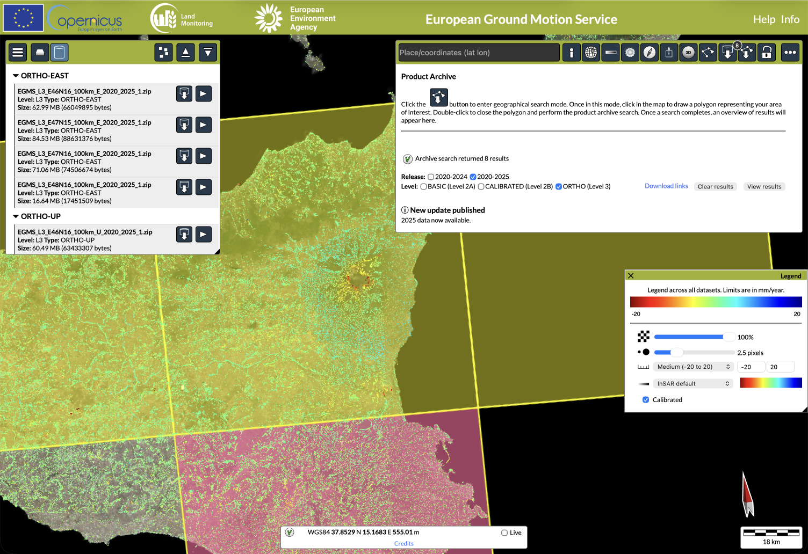

# InSAR ground motion from EGMS (Etna)

## Goal

The [European Ground Motion Service](https://egms.land.copernicus.eu) (EGMS) of the Copernicus Land Monitoring Service provides ground motion for the whole of Europe, derived from Sentinel-1 radar interferometry (InSAR). For millions of measurement points it gives a time series of the displacement, with a new value every 6 to 12 days and a precision of millimeters.

In this tutorial you will learn how to:
- download EGMS data for a region from the EGMS Explorer,
- read it in julia,
- compute velocities over a period of your choice, and
- put those on the topography, to visualize them in Paraview.

As example we use Mt. Etna (Sicily, Italy), where the summit area inflates and deflates with the magmatic activity while the eastern flank slides towards the sea.

## 1. Which data to download

EGMS comes in three levels. All can be read with `import_EGMS`, but they are not equally easy to interpret:

| Level | Name | What it is | When to use |
|:------|:-----|:-----------|:------------|
| L3  | Ortho      | Vertical and east-west motion on a regular 100 m grid, in 100 x 100 km tiles | **The one to take in most cases** |
| L2b | Calibrated | Motion along the line of sight of the satellite at every measurement point, tied to a GNSS reference frame; one file per satellite track and burst | If you need the full resolution, or want to work with the line of sight yourself |
| L2a | Basic      | As L2b, but only relative to a local reference point | Local studies of single structures |

The Ortho level combines the ascending and descending satellite tracks into two components, which come as separate files: `U` (up, the vertical motion) and `E` (east; positive is towards the east). InSAR is nearly insensitive to motion in the north-south direction, so there is no north component.

## 2. Download the data

Downloading requires a free [EU Login](https://ecas.ec.europa.eu/cas/eim/external/register.cgi) account, so this step has to be done by hand:

1. Open the EGMS Explorer at [https://egms.land.copernicus.eu](https://egms.land.copernicus.eu) and click the padlock icon in the toolbar (`Sign in with EU Login`). Create an account first if you do not have one yet. Looking at the map works without it, but searching and downloading products does not.
2. Zoom to your region of interest; you can type `Etna` or the coordinates (`37.75 15.0`) in the `Place/coordinates` box. Clicking on a point of the map shows its time series, which is a good way to check that there is something of interest before downloading.
3. Click the `Geographic archive search` button in the toolbar (the polygon with a downward arrow; it is also shown in the `Product Archive` panel that opens). Then click on the map to draw a polygon around your region, and double-click to close it. That starts the search.
4. In the `Product Archive` panel, tick the `Release` you want, for example `2020-2025`, and as `Level` tick `ORTHO (Level 3)` only. Every release covers about five years and only the latest two are offered.
5. The files that were found are now listed on the left, in two groups: `ORTHO-EAST` (the east-west motion) and `ORTHO-UP` (the vertical motion). Each row is one file, with its name and size, and the first of the two buttons next to it downloads it. The tiles themselves are outlined on the map.



   Every tile comes as two separate files, one in each group. The name of a file tells you what it is:

   `EGMS_L3_E47N16_100km_U_2020_2025_1.zip`

   | Part | Meaning |
   |:-----|:--------|
   | `L3` | the level (Ortho) |
   | `E47N16` | the tile, a square of 100 x 100 km |
   | `U` or `E` | the component: `U` is the vertical (up) motion, `E` the east-west motion |
   | `2020_2025` | the release |
   | `1` | the version of the file |

   The search lists every tile that the polygon touches, which in the example above are four. You only need the ones that cover your region: Etna lies entirely within tile `E47N16`, so for this tutorial download these two files (about 70 MB each):
   - `EGMS_L3_E47N16_100km_U_2020_2025_1.zip` from the `ORTHO-UP` group (vertical)
   - `EGMS_L3_E47N16_100km_E_2020_2025_1.zip` from the `ORTHO-EAST` group (east-west)
6. Unzip them and put the `.csv` files in the directory you work in. Each zip file also holds a GeoTIFF with the mean velocity only, which we do not use here.

The version is increased if EGMS delivers a corrected file, so yours may end with `_2`.

The name of a tile gives its lower left corner in the map projection of EGMS (ETRS89-LAEA, EPSG:3035) in units of 100 km: `E47N16` starts at an easting of 4700 km and a northing of 1600 km. If you want to know beforehand which tile a point is in:

```julia
julia> using GeophysicalModelGenerator
julia> E, N = GeophysicalModelGenerator.lonlat_to_laea(15.0, 37.75)
(4.764602103002746e6, 1.6447430091033338e6)
```

An unzipped tile is a large text file. If you open it with a text editor, it starts like:
```
pid,easting,northing,height_ortho,rmse_ts,mean_velocity,mean_velocity_std,acceleration,acceleration_std,seasonality,seasonality_std,gnss_velocity_n,gnss_velocity_e,gnss_velocity_u,20201209,20201215,20201221,...
10JVqNtNeK,4700050,1600050,497.5,2.5,-0.7,0.1,-0.37,0.16,1.4,0.1,3.6,-1.2,-0.5,-1.8,-1.7,-2.0,...
```
After the coordinates and a few statistics of each point, there is one column for every date (every 6 days) with the displacement in mm. Only changes of the displacement with time are meaningful, as the values do not start at zero. Releases before 2020-2024 use slightly different column names (`height` and `rmse`), which `import_EGMS` handles as well.

## 3. Read the data

A tile is much larger than the volcano, so we only keep the points within the region `[lon_min, lon_max, lat_min, lat_max]`:

```julia
julia> using GeophysicalModelGenerator, Dates
julia> limits = [14.7, 15.3, 37.5, 38.0]
julia> up = import_EGMS("EGMS_L3_E47N16_100km_U_2020_2025_1.csv", limits = limits)
EGMSData
  points    : 101560
  lon       ϵ [ 14.700002984094718 : 15.299935652997434]
  lat       ϵ [ 37.50000974271099 : 37.99995772116388]
  dates     : 302 from 2020-12-09 to 2025-11-19
  fields    : (:rmse_ts, :mean_velocity, :mean_velocity_std, :acceleration, :acceleration_std, :seasonality, :seasonality_std, :gnss_velocity_n, :gnss_velocity_e, :gnss_velocity_u)
```

Reading takes a few seconds, as the whole file of 270 MB has to be gone through. The result holds the location of the points (`up.lon`, `up.lat`, and `up.height` in m above the geoid), the acquisition dates (`up.dates`), the displacement in mm of every point at every date (`up.displacement[idate, ipoint]`) and the remaining columns of the file (`up.fields`). Of those, `up.fields.mean_velocity` is the velocity in mm/yr over the whole period of the release as computed by EGMS. Note that this release starts in December 2020 and not in January: check `up.dates` to see which period your file covers.

If your region extends over several tiles, pass a vector of file names, or the name of the directory that holds them, and they are combined. Read the `U` and `E` files separately though, as they are different quantities.

## 4. Velocities over a period

A volcano does not move at a constant rate, so the average over the whole period is often not what you are after. `EGMS_velocity` fits a straight line through the part of the time series between two dates:

```julia
julia> v_2021 = EGMS_velocity(up, from = Date(2021, 1, 1), to = Date(2021, 12, 31))
julia> v_2023 = EGMS_velocity(up, from = Date(2023, 1, 1), to = Date(2023, 12, 31))
```

The result is a vector with the velocity in mm/yr of every point. Many points move up and down with the seasons (groundwater, temperature). If the period is at least a year long, a yearly signal is therefore fitted along with the straight line, so that it does not end up in the velocity. You can switch this on or off with the `seasonal` keyword. Keep in mind that the shorter the period, the larger the uncertainty of the velocity. Without dates, the whole period of the file is used, and the result then agrees with the `mean_velocity` of EGMS to within a few hundredths of a mm/yr.

## 5. Put the velocities on the topography

Next, we load the topography of the same region. A resolution of 3 arc seconds (about 90 m) is close to the 100 m spacing of the data:

```julia
julia> Topo = import_topo(limits, res = "03s")
```

`EGMS_on_grid` computes the velocity over a period and gives every point of the topography the average of the measurement points next to it:

```julia
julia> Etna = EGMS_on_grid(up, Topo, from = Date(2021, 1, 1), to = Date(2021, 12, 31))
GeoData
  size      : (721, 601, 1)
  lon       ϵ [ 14.7 : 15.3]
  lat       ϵ [ 37.5 : 38.0]
  depth     ϵ [ -1.6988500000000004 : 3.313]
  fields    : (:Topography, :velocity, :npoints, :Velocity)
```

The fields that are added to the topography are:
- `velocity`: the velocity in mm/yr,
- `npoints`: the number of measurement points that were averaged at that grid point,
- `Velocity`: the same velocity as a vector, to plot arrows (see below).

InSAR does not work over water, dense vegetation or snow (such as the summit of Etna in winter), so there are gaps in the data. These are not filled: grid points without measurement points nearby have a velocity of `NaN`.

#### Search radius and smoothing

A few keywords control how the measurement points are averaged:

| Keyword | Default | What it does |
|:--------|:--------|:-------------|
| `radius`    | the size of a grid cell, at least 0.1 km | Distance in km within which measurement points are used. A larger radius closes gaps that are narrower than it. |
| `smooth`    | `false` | With `true`, nearby points count more than distant ones (a Gaussian weight of width `radius/3`), which gives a smoother map. The default `radius` is then three times larger. |
| `minpoints` | `10` | Where there is plenty of data, the radius is reduced locally to the smallest one that still holds this many points (but not below the size of a grid cell). `Inf` switches that off. |

```julia
julia> Etna_smooth = EGMS_on_grid(up, Topo, from = Date(2021, 1, 1), to = Date(2021, 12, 31), smooth = true, radius = 1.0)
```

Two properties are worth knowing:
- The result is always an average of measured values, with or without smoothing. It can therefore never show larger velocities than the data has.
- Because of `minpoints`, a large `radius` is only used in full where data is sparse. Where data is dense the radius shrinks, so that sharp steps in the velocity, such as across the faults that bound the sliding eastern flank of Etna, are not smoothed away. If such steps still look blurred, lower `minpoints`.

#### Vectors

The result has the vector field `Velocity`, so that the motion can be shown as arrows. With only the vertical file, the arrows point up or down. If you also pass the east-west file, they show the motion in the east-up plane (EGMS has no north-south component, so that part of the vector is zero), and the east-west velocity is added as the scalar field `velocity_east`:

```julia
julia> east = import_EGMS("EGMS_L3_E47N16_100km_E_2020_2025_1.csv", limits = limits)
julia> Etna = EGMS_on_grid(up, Topo, east = east, from = Date(2021, 1, 1), to = Date(2021, 12, 31))
GeoData
  size      : (721, 601, 1)
  lon       ϵ [ 14.7 : 15.3]
  lat       ϵ [ 37.5 : 38.0]
  depth     ϵ [ -1.6988500000000004 : 3.313]
  fields    : (:Topography, :velocity, :npoints, :velocity_east, :Velocity)
```

You can add more fields to the same surface, for example the vertical velocity over another period:

```julia
julia> Etna_2023 = EGMS_on_grid(up, Topo, from = Date(2023, 1, 1), to = Date(2023, 12, 31))
julia> Etna = addfield(Etna, "Vz_2023", Etna_2023.fields.velocity)
```

And save it to Paraview:

```julia
julia> write_paraview(Etna, "Etna_EGMS")
Saved file: Etna_EGMS.vts
```

In Paraview, open `Etna_EGMS.vts` and color the surface by `velocity` or `velocity_east`. A diverging colormap that is symmetric around zero works best. Points without data are shown in the `NaN` color, which you can set in the colormap editor. The eastward sliding of the eastern flank of the volcano should be clearly visible in `velocity_east`.

To plot arrows, select the `Glyph` filter, choose `Velocity` as both Orientation and Scale Array, set the Glyph Mode to `Every Nth Point` to thin them out, and adjust the scale factor. Points without data have no arrow.

If you do not need the topography, you can also interpolate to a regular grid at sea level, here with a spacing of 0.005 degrees:

```julia
julia> Grid = EGMS_on_grid(up, 14.7:0.005:15.3, 37.5:0.005:38.0)
```

## 6. Save the individual points

To look at the measurement points themselves rather than at an interpolated surface, convert them to a set of points. They are placed at their own height, and next to the `velocity` over the period they carry the other columns of the file:

```julia
julia> Points = EGMS_points(up, from = Date(2021, 1, 1), to = Date(2021, 12, 31))
julia> write_paraview(Points, "Etna_EGMS_points", PointsData = true)
Saved file: Etna_EGMS_points.vtu
```

## 7. Time series of a point

The displacements are available as well, for example to plot the time series of the point closest to a given location:

```julia
julia> i = argmin((up.lon .- 15.10) .^ 2 .+ (up.lat .- 37.70) .^ 2)
julia> up.dates, up.displacement[:, i]      # dates and displacement in mm
```

## Reference

The data is free to use, but EGMS asks you to cite it; see the [product page](https://land.copernicus.eu/en/products/european-ground-motion-service) for the reference and the documentation of the processing.
