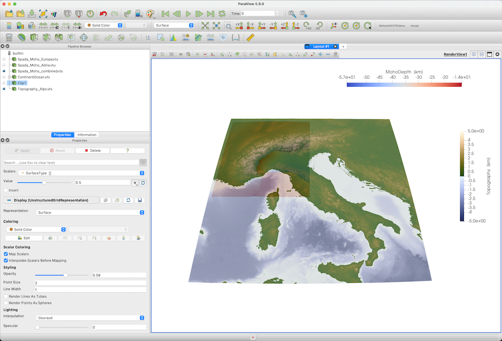

# Download topographic data with import_topo

## Goal

In many cases, we want to add topographic data as well to our visualization. This tutorial shows how to use `import_topo` to download data from a certain region of the [GMT data server](https://www.generic-mapping-tools.org/remote-datasets/) and transfer it to `GMG`. The `GMT` package is not needed.

## Steps

#### 1. Download topographic data of the Alpine region

The function `import_topo` automatically downloads data for you for a certain region and with a certain resolution.

```julia
julia> using GeophysicalModelGenerator
julia> Topo = import_topo([4,20,37,49], file="@earth_relief_01m")
GeoData 
  size  : (961, 721, 1)
  lon   ϵ [ 4.0 : 20.0]
  lat   ϵ [ 37.0 : 49.0]
  depth ϵ [ -3.8725 km : 4.2495 km]
  fields: (:Topography,)
```

The data is available in different resolutions:

| Dataset                 |   Resolution |   Description                                               |
|:----------------        | ------------ | ----------------------------------------------------------- |
| "@earth\_relief\_01s" |	1 arc sec 	 | SRTM tiles (14297 tiles, land only, 60S-60N) [NASA/USGS]    |
| "@earth\_relief\_03s"	|   3 arc sec	 | SRTM tiles (14297 tiles, land only, 60S-60N) [NASA/USGS]    |
| "@earth\_relief\_15s"	|  15 arc sec	 | SRTM15+ [David Sandwell, SIO/UCSD]                          |
| "@earth\_relief\_30s"	|  30 arc sec	 | SRTM30+ [Becker et al., 2009, SIO/UCSD]                     |
| "@earth\_relief\_01m"	|   1 arc min	 | ETOPO1 Ice surface [NEIC/NOAA]                              |
| "@earth\_relief\_02m"	|   2 arc min	 | ETOPO2v2 Ice surface [NEIC/NOAA]                            |
| "@earth\_relief\_03m"	|   3 arc min	 | ETOPO1 after Gaussian spherical filtering (5.6 km fullwidth)|
| "@earth\_relief\_04m"	|   4 arc min	 | ETOPO1 after Gaussian spherical filtering (7.5 km fullwidth)|
| "@earth\_relief\_05m"	|   5 arc min	 | ETOPO1 after Gaussian spherical filtering (9 km fullwidth)  |
| "@earth\_relief\_06m"	|   6 arc min	 | ETOPO1 after Gaussian spherical filtering (10 km fullwidth) |
| "@earth\_relief\_10m"	|  10 arc min	 | ETOPO1 after Gaussian spherical filtering (18 km fullwidth) |
| "@earth\_relief\_15m"	|  15 arc min	 | ETOPO1 after Gaussian spherical filtering (28 km fullwidth) |
| "@earth\_relief\_20m"	|  20 arc min	 | ETOPO1 after Gaussian spherical filtering (37 km fullwidth) |
| "@earth\_relief\_30m"	|  30 arc min	 | ETOPO1 after Gaussian spherical filtering (55 km fullwidth) |
| "@earth\_relief\_01d"	|   1 arc deg	 | ETOPO1 after Gaussian spherical filtering (111 km fullwidth)|

Generally, it is advisable to not use the largest resolution if you have a large area. 

#### 2. Save
Transforming this to Paraview is a piece of cake:

```julia
julia> write_paraview(Topo, "Topography_Alps") 
```
The result is shown here, together with Moho data



In case you are interested: we are employing the `oleron` scientific colormap [here](https://www.fabiocrameri.ch/colourmaps/).
