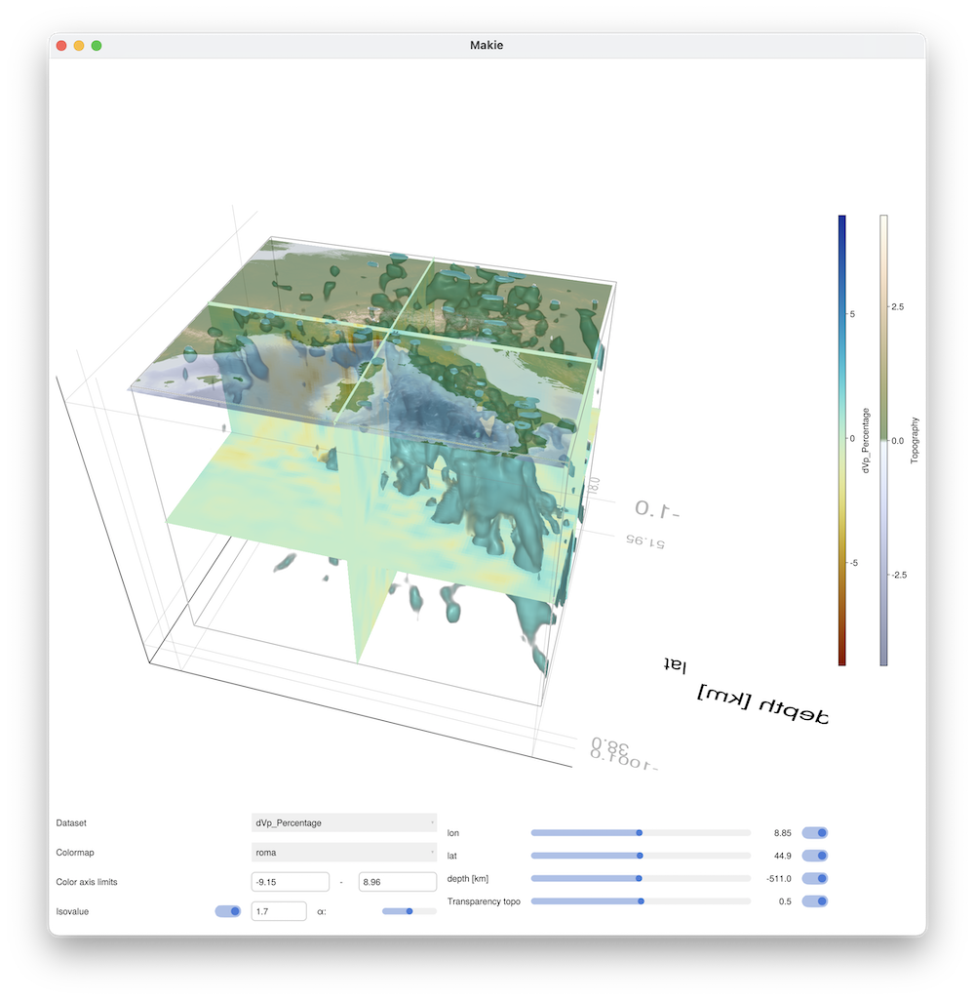

# Visualisation

The standard visualisation way of GMG is to generate Paraview (VTK) files & look at them there.
Yet, often we just want to have a quick look at the data without opening a new program.
For that reason, we created the `visualise` widget, which uses `GLMakie` and allows you to explore the data.
The tutorial [Quick look with GLMakie](Tutorial_Visualise.md) shows it step by step, with data that is downloaded automatically.

It requires you to load both `GLMakie` and `GeophysicalModelGenerator`. A small example in which we load the tomography data of the Alps is:
```julia
julia> using GeophysicalModelGenerator, GLMakie
julia> Tomo_full = load_GMG("https://zenodo.org/records/10738510/files/Paffrath_2021_SE_Pwave.jld2?download=1");
julia> Data = extract_subvolume(Tomo_full, Lon_level = (4, 20), Lat_level = (36, 50), Depth_level = (-600, -10));
julia> Topo = load_GMG("https://zenodo.org/records/10738510/files/AlpsTopo.jld2?download=1");
```
At this stage you can look at the data with
```julia
julia> fig = visualise(Data);
```
`visualise` returns the `Figure`, which can be saved with `save`. The isosurface starts switched off; the **Isovalue** toggle shows it.
Note that this tends to take a while the first time you do this (faster afterwards).

Let's add the topography to the plot as well:
```julia
julia> visualise(Data, Topography=Topo);
```
Which will look like:



This is an example where we used `GeoData` to visualize results. Alternatively, we can also visualize results in km (often more useful for numerical modelling setups). For `visualise` to work with this, we however need orthogonal Cartesian data, which is obtained by projecting the data. The grid must lie inside the region covered by the data; points outside it become `NaN`.
```julia
julia> p = ProjectionPoint(Lon=12.0, Lat=43)
julia> Data_Cart = CartData(xyz_grid(-550.0:10:600, -500.0:10:700, -600.0:5:-17));
julia> Topo_Cart = CartData(xyz_grid(-550.0:5:600, -500.0:5:700, 0));
julia> Data_Cart = project_CartData(Data_Cart, Data, p);
julia> Topo_Cart = project_CartData(Topo_Cart, Topo, p);
```
And once we have done that, you can visualize the data in the same way:
```julia
julia> visualise(Data_Cart, Topography=Topo_Cart)
```

```@docs
visualise
```